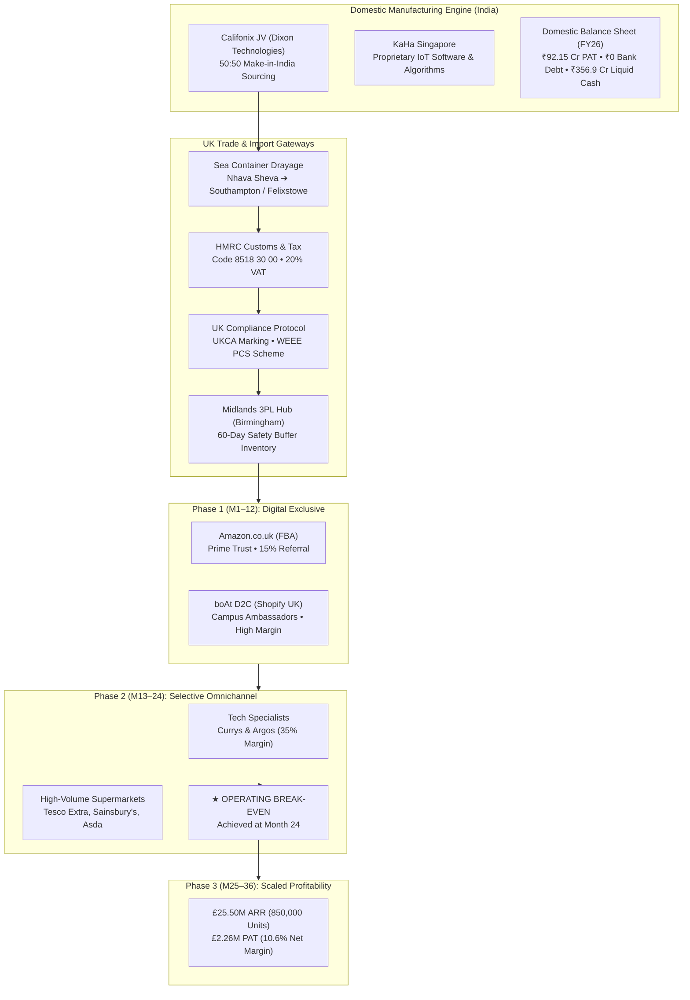
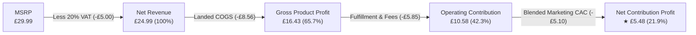
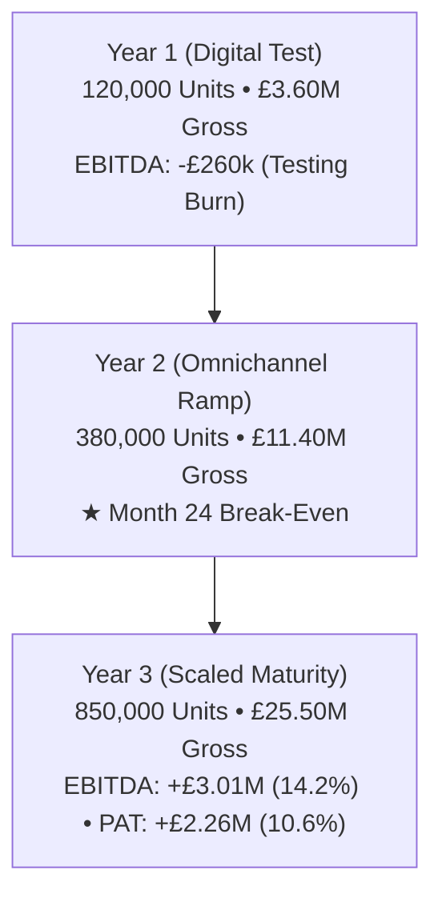

# 🎧 boAt UK Market Entry Strategy & Financial Engine
### Institutional Corporate Strategy • International Market Entry Feasibility • Unit Economics • 3-Year Pro-Forma Model (2027–2029)

<div align="center">

[](LICENSE)
[](dashboard/)
[](dashboard/)
[](dashboard/)
[](analysis/)
[](docs/audited_financials/)
[](#)

**Target Roles:** Corporate Strategy Lead / Manager • Management Consulting Associate • Senior Business / Data Analyst  
**Company Analyzed:** Imagine Marketing Limited (`boAt`) | **Industry:** Consumer Electronics & Personal Audio  
**Target Market:** United Kingdom ($576.9M Hearables TAM) | **Horizon:** 2027–2029

[📥 Download Master Stakeholder Report (PDF)](boAt_UK_Market_Entry_Strategy_Master_Report.pdf) • [📑 Read 10-Section Consulting Dossier](docs/strategy/boAt_UK_Market_Entry_Master_Consulting_Report.md) • [💻 Launch Interactive Dashboard](#-how-to-run-locally)

</div>

---

## 📑 Table of Contents
1. [Executive Summary & Strategic Thesis](#-executive-summary--strategic-thesis)
2. [Master Deliverables Index](#-master-deliverables-index)
3. [Strategic Architecture & 3-Phase Rollout](#-strategic-architecture--3-phase-rollout)
4. [Per-Unit Landed Economics & Margin Waterfall](#-per-unit-landed-economics--margin-waterfall)
5. [Competitive Landscape & 2×2 Positioning](#-competitive-landscape--22-positioning)
6. [Multi-Channel Commercial Distribution Matrix](#-multi-channel-commercial-distribution-matrix)
7. [3-Year Pro-Forma Income Statement (2027–2029)](#-3-year-pro-forma-income-statement-20272029)
8. [Audited Financial Turnaround (boAt India FY23–FY26)](#-audited-financial-turnaround-boat-india-fy23fy26)
9. [UK Regulatory, Customs & Compliance Architecture](#-uk-regulatory-customs--compliance-architecture)
10. [Interactive React 19 Dashboard Tour](#-interactive-react-19-dashboard-tour)
11. [Repository File & Directory Structure](#-repository-file--directory-structure)
12. [How to Run Locally](#-how-to-run-locally)
13. [Quantified Resume & Portfolio Highlights](#-quantified-resume--portfolio-highlights)
14. [Author & License](#-author--license)

---

## 📌 Executive Summary & Strategic Thesis

This repository contains an institutional-grade **Corporate Strategy, Regulatory Architecture, and Financial Expansion Model** evaluating the feasibility of **Imagine Marketing Limited (boAt)**—India’s #1 digital-first hearables brand—executing a phased international expansion into the **United Kingdom Personal Audio Market ($576.9M TAM)**.

### The Strategic Verdict:
boAt must execute a **capital-efficient, phased digital-to-omnichannel rollout**:
* **Phase 1 (Months 1–12): Digital Exclusive Testing** — Deploy exclusively through an asset-light **Amazon UK (FBA) + D2C Shopify UK** model to capture high-margin early adopters, validate product-market fit, and establish algorithmic review authority without fixed retail overheads.
* **Phase 2 (Months 13–24): Selective Omnichannel Wholesale** — Expand into tech specialists (**Argos, Currys**) and high-volume grocery supermarket giants (**Tesco Extra, Sainsbury’s, Asda**), achieving **operating break-even at Month 24**.
* **Phase 3 (Months 25–36): Scaled Profitability** — Reach **£25.50M Gross ARR** (850,000 units), generating **£3.01M Operating EBITDA (14.2%)** and **£2.26M Net Profit After Tax (10.6%)**.

### Grounded in Real Audited Filings & Primary Legislation:
1. **Audited Financial Statements (FY23, FY24, FY25, FY26)** and the **SEBI Draft Red Herring Prospectus (DRHP)** of Imagine Marketing Limited.
2. **Post-Brexit UK Regulatory Statues**:
   - **HMRC Integrated Online Tariff** (Commodity Code `8518 30 00` & standard 20% UK VAT).
   - **Department for Business & Trade UKCA Directives** (Radio Equipment Regulations 2017 SI 2017/1206, UK Designated Standards, Declaration of Conformity).
   - **DEFRA & OPSS WEEE Regulations 2013/2025** (Producer Compliance Scheme quotas, battery weight recovery, BS EN 50419 crossed-out wheelie bin labeling).
3. **Domestic Sourcing Scale**:
   - 50:50 Make-in-India Joint Venture with **Dixon Technologies (Califonix Tech)** producing over ₹534 Cr of hardware annually.
   - 100% ownership of **KaHa Pte Ltd (Singapore)** providing proprietary IoT companion app software and health algorithms.

---

## 📦 Master Deliverables Index

| Deliverable | File Path | Description |
| :--- | :--- | :--- |
| **Executive PDF Report** | [`boAt_UK_Market_Entry_Strategy_Master_Report.pdf`](boAt_UK_Market_Entry_Strategy_Master_Report.pdf) | Publication-grade 10-section consulting PDF report with vector charts, financial models, and executive stamp (470 KB). |
| **Master Consulting Dossier** | [`docs/strategy/boAt_UK_Market_Entry_Master_Consulting_Report.md`](docs/strategy/boAt_UK_Market_Entry_Master_Consulting_Report.md) | Exhaustive, board-level strategic document (Doc ID: `STRAT-UK-2026-BOAT-01`). |
| **Interactive Web Dashboard** | [`dashboard/`](dashboard/) | Modern React 19 + Vite + Tailwind CSS v4 web application with 7 interactive tabs, real-time FX switcher, and sensitivity simulator. |
| **Printable HTML Dossier** | [`analysis/report_printable.html`](analysis/report_printable.html) | Standalone responsive HTML report with embedded SVG data visualizations. |
| **PDF Generation Engine** | [`analysis/generate_pdf_report.py`](analysis/generate_pdf_report.py) | Automated Python pipeline compiling executive reports via headless Chromium/Edge. |
| **Unit Economics Engine** | [`analysis/unit_economics_engine.py`](analysis/unit_economics_engine.py) | CLI waterfall engine modeling landed costs, tariffs, VAT, and channel fee splits. |
| **Financial Turnaround Audit** | [`analysis/financial_turnaround_audit.py`](analysis/financial_turnaround_audit.py) | Python verification script auditing boAt’s FY23–FY26 balance sheet transformation. |

---

## 🏛️ Strategic Architecture & 3-Phase Rollout



---

## ⚖️ Per-Unit Landed Economics & Margin Waterfall

For a flagship entry SKU (**boAt Airdopes UK Edition**) retailing at **£29.99 MSRP**:



### Granular Cost Buildup Table:
| Step / Cost Component | Regulatory / Commercial Basis | Amount (£) | % of Net Revenue |
| :--- | :--- | :---: | :---: |
| **Gross Retail Selling Price (MSRP)** | Consumer shelf / digital checkout price | **£29.99** | — |
| **Less: UK Value Added Tax (VAT)** | HMRC VAT Act 1994 (Mandatory 20% inclusive) | **-£5.00** | — |
| **Net Realized Revenue** | **Realized top-line cash baseline** | **£24.99** | **100.0%** |
| Manufacturing FOB (India) | Califonix Tech JV (Dixon Technologies) | -£7.20 | 28.8% |
| Ocean Freight & Marine Insurance | 40ft Container drayage (Nhava Sheva to Southampton) | -£0.85 | 3.4% |
| HMRC Customs Duty (2.0%) | Commodity Code `8518 30 00` (Headphones/Earphones) | -£0.16 | 0.6% |
| UKCA & WEEE Compliance Levy | UK Authorized Rep retainer + Valpak PCS recycling quota | -£0.35 | 1.4% |
| **Total Landed Product Cost (COGS)** | **Factory floor to Birmingham 3PL warehouse** | **-£8.56** | **34.3%** |
| **Gross Product Margin** | **Factory-to-Warehouse Gross Profit** | **£16.43** | **65.7%** |
| Channel Fulfillment & Retailer Fee | Amazon FBA take-rate / Retailer wholesale margin | -£5.85 | 23.4% |
| Customer Acquisition Cost (CAC) | TikTok UK creator ad spend, micro-influencers, student reps | -£5.10 | 20.4% |
| **Net Contribution Margin per Unit** | **Net operating cash generation per unit** | **£5.48** | **21.9%** |

---

## 🎯 Competitive Landscape & 2×2 Positioning

The UK personal audio market exhibits severe price bifurcation between legacy premium audio brands and commoditized unbranded white-label products. boAt targets the **uncontested Value-Fashion whitespace**:

```
High Feature Density
       │                                  [boAt SWEET SPOT]
       │                         ★ boAt Airdopes UK (£29–£49)
       │                         (ANC, 40h Battery, Fashion Aesthetics,
       │                          Aggressive Gen-Z Bass Signature)
       │
       │   Anker Soundcore (£40–£70)
       │   (Utilitarian, Tech-Focused)           Sony & Apple (£150–£280)
       │                                         (Aspirational Luxury)
       │
───────┼─────────────────────────────────────────────────────────────
       │
       │   JLab & Skullcandy (£20–£35)
       │   (Entry-Level High Street)
       │
       │   Amazon White-Label / Temu (<£15)
       │   (Zero Brand Equity, Disposable)
       │
Low Feature Density
       └─────────────────────────────────────────────────────────────
      £0                          £50                        £250+
                              Price Floor (MSRP)
```

---

## 🏬 Multi-Channel Commercial Distribution Matrix

| Channel | Format | Role & Go-To-Market Mechanics | Commercial Terms | Volume Mix (Y1 $\to$ Y3) |
| :--- | :--- | :--- | :--- | :---: |
| **Amazon.co.uk (FBA)** | Digital Marketplace | Immediate Prime trust badge, Buy Box ranking, algorithm review scaling | 15% Referral + £2.85 FBA pick/pack | 65% $\to$ 28% |
| **boAt D2C (Shopify)** | Brand Flagship Web | First-party customer data capture, campus student bundles, exclusive transparent editions | 2.4% + 20p gateway + £2.95 3PL fulfillment | 35% $\to$ 22% |
| **Argos & Currys** | Tech Specialists | Argos catalogue click-and-collect in 1,100+ locations; Currys physical shelf authority | 35% Wholesale Margin off MSRP (Net 60 Days) | 0% $\to$ 28% |
| **Supermarkets (Tesco/Asda)** | Mass Grocery Retail | Unrivaled footfall; impulse checkout aisle purchases; Back-to-School volume surges | 38% Wholesale Margin + 4% co-op ad allowance | 0% $\to$ 22% |

---

## 📊 3-Year Pro-Forma Income Statement (2027–2029)



| Financial Metric | Year 1 (Digital Launch) | Year 2 (Omnichannel Ramp) | Year 3 (Scaled Maturity) | Strategic Trend |
| :--- | :---: | :---: | :---: | :---: |
| **Target Units Sold** | 120,000 | 380,000 | **850,000** | +166% CAGR |
| **Gross Revenue (MSRP)** | £3.60M | £11.40M | **£25.50M** | ₹267.8 Cr equivalent |
| Less: UK VAT (20%) | -£0.60M | -£1.90M | -£4.25M | Standard statutory rate |
| **Net Realized Revenue** | **£3.00M (100%)** | **£9.50M (100%)** | **£21.25M (100%)** | Net top-line basis |
| Landed COGS (FOB + Freight + Duty) | -£1.03M (34.3%) | -£3.26M (34.3%) | -£7.29M (34.3%) | Fixed unit cost efficiency |
| **Gross Product Profit** | **£1.97M (65.7%)** | **£6.24M (65.7%)** | **£13.96M (65.7%)** | Resilient product margin |
| Channel Fulfillment & Retailer Margins | -£0.74M (24.7%) | -£3.15M (33.2%) | -£7.12M (33.5%) | Wholesale volume shift |
| Marketing & Customer Acquisition (CAC) | -£1.14M (38.0%) | -£1.85M (19.5%) | -£2.85M (13.4%) | Organic brand recall scale |
| Fixed UK Overheads (UKCA, WEEE, Legal) | -£0.35M (11.7%) | -£0.65M (6.8%) | -£0.98M (4.6%) | Operating leverage |
| **Operating EBITDA** | **-£0.26M (-8.7%)** | **+£0.59M (+6.2%)** | **+£3.01M (+14.2%)** | **Inflects to profit in Y2** |
| Less: UK Corporate Tax (25%) | £0.00 | -£0.15M | -£0.75M | HMRC statutory rate |
| **Net Profit After Tax (PAT)** | **-£0.26M** | **+£0.44M (4.6%)** | **+£2.26M (10.6%)** | **Sustainable net ARR** |

---

## 📈 Audited Financial Turnaround (boAt India FY23–FY26)

Extracted directly from boAt's audited standalone and consolidated annual financial statements and SEBI DRHP filing:

| Metric (Standalone ₹ Cr) | FY 2022-23 | FY 2023-24 | FY 2024-25 | FY 2025-26 | Turnaround Delta |
| :--- | :---: | :---: | :---: | :---: | :---: |
| **Revenue from Operations** | ₹3,284.76 | ₹3,121.60 | ₹3,089.64 | ₹2,928.08 | Post-COVID normalization |
| **EBITDA Margin (%)** | -1.53% | +0.45% | +4.17% | **+7.02%** | **+855 bps expansion** |
| **Net Profit After Tax (PAT)** | -₹101.04 | -₹53.59 | +₹64.22 | **+₹92.15** | **+₹193.2 Cr swing** |
| **Short-Term Bank Borrowings** | ₹732.99 | ₹356.19 | ₹90.07 | **₹0.00** | **100% Debt Free** |
| **Liquid Reserves (Cash + FDs + Funds)** | ₹139.23 | ₹246.76 | ₹277.11 | **₹356.92** | **₹350+ Cr War Chest** |
| **International Export Sales** | ₹8.50 | ₹10.75 | ₹11.70 | **₹41.90** | **+258% YoY surge** |

> **Takeaway for Board & Investors:** Peak cumulative cash burn during UK expansion is £1.10M (~₹11.5 Cr), representing **less than 1.2%** of boAt’s liquid domestic reserves, eliminating parent insolvency risks.

---

## ⚖️ UK Regulatory, Customs & Compliance Architecture

```
                    ┌──────────────────────────────────────────────┐
                    │  HMRC Customs & Valuation (Import Baseline)  │
                    │  Commodity Code: 8518 30 00 (Headphones)     │
                    │  Standard 20% Import VAT • 2.0% Third-Country│
                    └──────────────────────┬───────────────────────┘
                                           │
                    ┌──────────────────────▼───────────────────────┐
                    │  UKCA Conformity & Statutory Directives      │
                    │  Radio Equipment Regulations 2017 SI 2017    │
                    │  UK Authorized Representative (UKAR) Entity  │
                    └──────────────────────┬───────────────────────┘
                                           │
                    ┌──────────────────────▼───────────────────────┐
                    │  DEFRA / OPSS WEEE & Battery Compliance      │
                    │  Waste Electrical & Electronic Equipment 2013│
                    │  Producer Compliance Scheme (Valpak Member)  │
                    └──────────────────────┬───────────────────────┘
                                           │
                    ┌──────────────────────▼───────────────────────┐
                    │  Midlands 3PL Distribution Hub (Birmingham)  │
                    │  Palletized Inbound • FBA Drayage • B2B EDI   │
                    └──────────────────────────────────────────────┘
```

1. **HMRC Integrated Online Tariff**:
   - Earphones and audio accessories classified under Commodity Code `8518 30 00`.
   - Customs valuation calculated under Transaction Value Method 1 (FOB price + sea freight + transit insurance).
   - Monthly deferment account utilized to optimize cash flow on import VAT.
2. **UKCA Marking Directives**:
   - Compulsory adherence to UK Radio Equipment Regulations 2017 (SI 2017/1206) and Electromagnetic Compatibility Regulations 2016.
   - Appointment of a Bristol/London-based UK Authorized Representative (UKAR) to maintain technical documentation for 10 years.
3. **WEEE & Battery Recycling Compliance**:
   - Registration with an approved UK Producer Compliance Scheme (e.g., Valpak) under DEFRA/OPSS mandates.
   - Product and packaging compliance under BS EN 50419 (Crossed-Out Wheelie Bin symbol, date marking, and battery disposal guidelines).

---

## 💻 Interactive React 19 Dashboard Tour

The repository features a fully functional, enterprise-grade data dashboard located in [`dashboard/`](dashboard/) built with **React 19**, **Vite 6**, **Tailwind CSS v4**, and **Recharts**.

### Key Architectural Tabs:
1. **Executive Summary Tab**: Real-time KPI banner, UK audio TAM sizing breakdown, and interactive 2×2 competitor positioning matrix.
2. **Domestic Foundation Tab**: Four-year financial turnaround audit (FY23–FY26), tracking the swing from -₹101 Cr loss to +₹92.15 Cr PAT and debt elimination.
3. **Unit Economics Tab**: Interactive landed cost waterfall with dynamic visual breakdown of COGS, duty, VAT, fulfillment, CAC, and net margin.
4. **Omnichannel Strategy Tab**: Comparative channel breakdown across Amazon FBA, D2C Shopify, Argos, Currys, and Supermarkets.
5. **3-Year Pro-Forma Tab**: Year-over-year revenue, gross profit, EBITDA, and PAT forecast tables, plus a 24-month cumulative cash runway J-curve.
6. **Risk & Sensitivity Simulator**: Live sliders adjusting MSRP (£20–£45), CAC (£2–£10), FX rates (₹/£), and freight costs with instant recalculation of break-even volume and net margins.
7. **Compliance & Logistics Tab**: Detailed regulatory workflows covering UKCA, WEEE, HMRC, and Midlands 3PL operations.

---

## 📁 Repository File & Directory Structure

```
Resume Project 2/
├── .gitignore                                      # Comprehensive exclusions (node_modules, dist, logs)
├── LICENSE                                         # MIT Open Source License
├── README.md                                       # Master Repository Documentation & Investment Thesis
├── boAt_UK_Market_Entry_Strategy_Master_Report.pdf # Executive Consulting PDF Deliverable (470 KB)
│
├── analysis/                                       # Python Analytical & Reporting Engines
│   ├── financial_turnaround_audit.py               # FY23-FY26 audited balance sheet audit script
│   ├── generate_pdf_report.py                      # Headless Edge automated PDF compilation script
│   ├── report_printable.html                       # Standalone responsive printable HTML report
│   └── unit_economics_engine.py                    # Landed cost waterfall & margin sensitivity CLI
│
├── docs/                                           # Audited Reports, Directives & Strategy Dossiers
│   ├── audited_financials/                         # Primary audited corporate filings & DRHP
│   │   ├── boAt_Annual_Report_25.pdf               # Statutory Annual Report FY25
│   │   ├── boAt_SFS_FY26_signed_AR 25.pdf          # Signed Audited Standalone Statements FY26
│   │   ├── Imagine_Marketing_Limited_Standalone 23.pdf # Audited Standalone Financials FY23
│   │   ├── Imagine_Marketing_Limited_-_Standalone 24.pdf # Audited Standalone Financials FY24
│   │   └── IMAGINE-MARKETING---DRHP_1779086774_77.pdf # SEBI Draft Red Herring Prospectus
│   ├── uk_regulations/                             # Primary UK regulatory legislation
│   │   ├── HMRC.pdf                                # HMRC Chapter 85 customs classifications
│   │   ├── UKCA Marking.pdf                        # UK Conformity Assessed directives & standards
│   │   └── WEEE.pdf                                # Waste Electrical & Electronic Equipment statutory rules
│   └── strategy/                                   # Core strategic documents
│       ├── boAt UK Market Entry Strategy.pdf       # Initial corporate strategy slide deck
│       ├── boAt_UK_Market_Entry_Master_Consulting_Report.md # Formal 10-section consulting markdown dossier
│       └── boAt_UK_Market_Entry_Strategy_Master_Report.pdf  # Strategy archive copy of master PDF
│
└── dashboard/                                      # Production React 19 + Vite + Tailwind CSS Application
    ├── index.html                                  # Root HTML with Plus Jakarta Sans & boAt dark theme
    ├── package.json                                # Application dependencies (React 19, Recharts, Lucide)
    ├── vite.config.js                              # Vite bundler configuration
    └── src/
        ├── App.jsx                                 # Master state controller & tab router
        ├── index.css                               # Tailwind CSS v4 styling & dark theme scrollbars
        ├── data/                                   # Structured analytical data stores
        │   ├── boAtFinancialData.js                # Audited financials (FY23-FY26)
        │   ├── proFormaForecastData.js             # 3-year P&L and 24-month cash flow projections
        │   ├── regulatoryComplianceData.js         # UKCA, WEEE, HMRC compliance rules
        │   ├── ukMarketData.js                     # Market size, competitors, price tiers
        │   └── unitEconomicsData.js                # Granular unit cost components & channel metrics
        └── components/                             # Modular presentation components
            ├── ComplianceLogisticsTab.jsx          # Regulatory & 3PL logistics overview
            ├── DomesticFoundationTab.jsx           # Balance sheet turnaround charts
            ├── ExecutiveSummaryTab.jsx             # KPI banner, 2x2 matrix, TAM sizing
            ├── Navbar.jsx                          # Navigation header with currency toggle
            ├── OmnichannelStrategyTab.jsx          # 5-channel distribution comparison
            ├── ProFormaModelTab.jsx                # 3-year P&L forecast & cash runway J-curve
            ├── ResumeModal.jsx                     # Interactive CV bullet points & portfolio modal
            ├── RiskSimulatorTab.jsx                # Real-time scenario & sensitivity sliders
            └── UnitEconomicsTab.jsx                # Landed cost waterfall & margin bridge
```

---

## 🚀 How to Run Locally

### 1. Run the Interactive React Dashboard
```bash
# Navigate to the dashboard directory
cd dashboard

# Install dependencies (React 19, Vite, Recharts, Lucide)
npm install

# Start development server
npm run dev
```
Open **`http://localhost:5173`** in your browser.

### 2. Run the Python Financial Models
```bash
# Calculate landed unit economics and channel margin bridge
python analysis/unit_economics_engine.py

# Audit FY23–FY26 balance sheet turnaround and solvency ratios
python analysis/financial_turnaround_audit.py

# Recompile the publication-grade PDF report
python analysis/generate_pdf_report.py
```

---

## 💼 Quantified Resume & Portfolio Highlights

```markdown
• Corporate Strategy & International Market Entry:
  Engineered an institutional-grade 3-year market entry strategy for boAt (Imagine Marketing Ltd) expanding into the UK ($576.9M TAM), projecting £25.50M Gross ARR and operating break-even at Month 24 across digital (Amazon FBA, D2C) and high-street wholesale channels (Argos, Currys, Tesco, Asda).

• Landed Unit Economics & Trade Tariff Modeling:
  Formulated a granular per-unit cost waterfall bridge (Califonix FOB, ocean freight, HMRC Commodity Code 8518 30 00, 20% UK VAT, UKCA, and WEEE compliance levies), sustaining a 65.7% gross product margin and 21.9% net unit contribution at a £29.99 MSRP.

• Financial Statement Auditing & Solvency Modeling:
  Synthesized 4 years of audited standalone & consolidated financials (FY23–FY26), tracking boAt's turnaround from a -₹101 Cr PAT loss to +₹92.15 Cr PAT and total liquidation of short-term bank debt to ₹0, proving self-funded expansion capability (<1.2% domestic cash at-risk).

• Dynamic Scenario Simulation & Omnichannel Analytics:
  Architected an interactive React 19/Tailwind data application stress-testing EBITDA, break-even unit volumes, and cash burn across 5 distribution channels under GBP/USD currency volatility and Red Sea maritime shipping shocks.
```

---

## 📜 Author & License

* **Author:** **Spoorthi Yadav K**  
* **Project Type:** Corporate Strategy & Management Consulting Portfolio Project  
* **License:** This project is licensed under the [MIT License](LICENSE).
