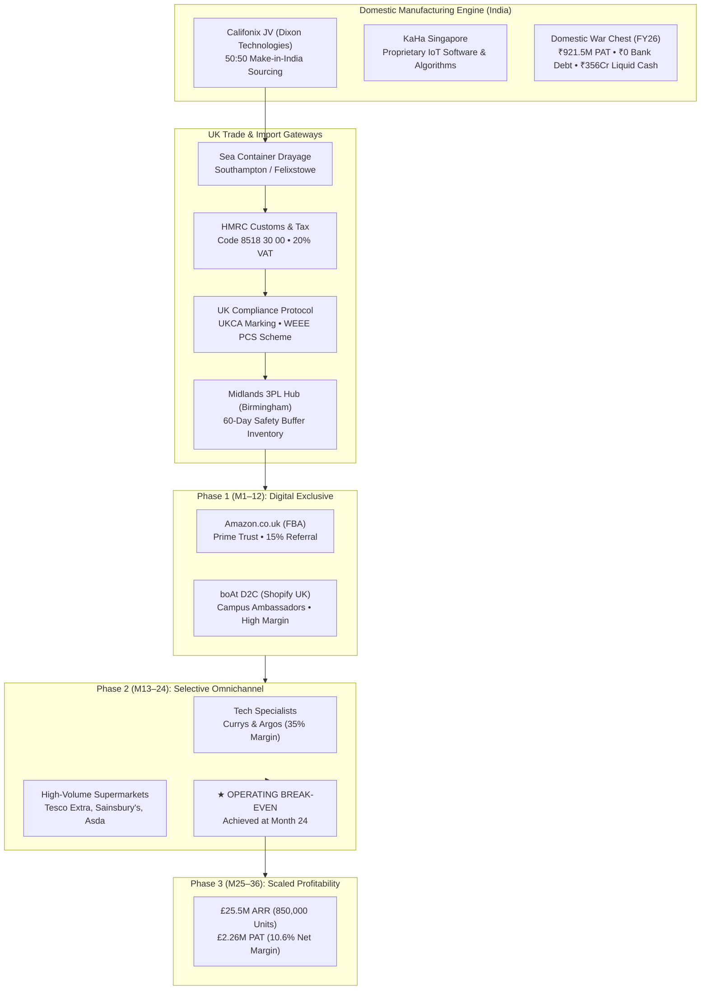
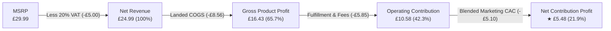
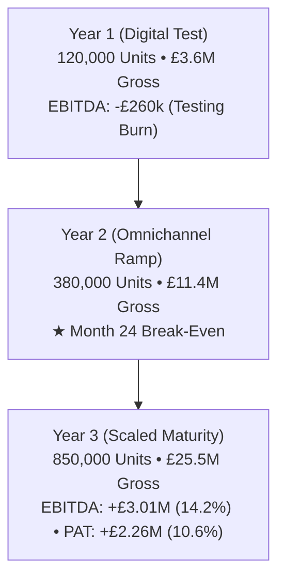

# 🎧 boAt UK Market Entry Strategy & Financial Engine
### Corporate Strategy • International Feasibility • Unit Economics • 3-Year Pro-Forma Model (2027–2029)
**Target Roles:** Corporate Strategy Manager / Analyst • Management Consulting Associate • Senior Business / Data Analyst  
**Company:** Imagine Marketing Limited (`boAt`) | **Industry:** Consumer Electronics & Personal Audio (Hearables/Wearables)

---

## 📌 Executive Summary & Investment Thesis

This project presents an institutional-grade **Corporate Strategy and Financial Expansion Model** evaluating the feasibility of **Imagine Marketing Limited (boAt)**—India's #1 digital-first hearables and wearables brand—executing a phased 3-year market entry into the **United Kingdom Personal Audio Market ($576.9M TAM)**.

### The Strategic Verdict:
boAt must execute a **phased, digital-first entry** into the UK. By bypassing capital-heavy greenfield retail initially, the company leverages an asset-light **Amazon UK (FBA) + D2C Shopify** architecture in Year 1, transitioning to selective high-street wholesale partnerships (**Argos, Currys**, and high-volume **Supermarkets: Tesco Extra, Sainsbury's, Asda**) in Year 2 to achieve **Month-24 operating break-even** and scale to **£25.5M ARR (850,000 units)** by Year 3 at a **10.6% Net PAT Margin**.

### Grounded in Real Data & Audited Filings:
1. **Audited Standalone & Consolidated Financial Statements (FY23, FY24, FY25, and FY26)** and the **Pre-filed Draft Red Herring Prospectus (DRHP)** filed with SEBI.
2. **Post-Brexit UK Regulatory Statues**:
   - **HMRC Integrated Online Tariff** (Commodity Code `8518 30 00` & standard 20% UK VAT).
   - **Department for Business & Trade UKCA Marking Directives** (Radio Equipment Regulations 2017, UK Authorized Representative, DoC).
   - **DEFRA & OPSS WEEE Regulations 2013/2025** (Producer Compliance Scheme quotas, battery weight recovery, BS EN 50419 labeling).
3. **Domestic Sourcing Scale**:
   - 50:50 Make-in-India Joint Venture with **Dixon Technologies (Califonix Tech)** producing over ₹534 Cr of hardware annually.
   - 100% ownership of **KaHa Pte Ltd (Singapore)** providing proprietary IoT companion app software and health algorithms.

---

## 🏛️ Strategic Architecture & Rollout Blueprint



---

## ⚖️ Per-Unit Landed Economics & Margin Waterfall

For a flagship entry SKU (**boAt Airdopes UK Edition**) priced at **£29.99 MSRP**:



### Detailed Cost Buildup Table:
| Step / Cost Component | Regulatory / Commercial Basis | Amount (£) | % of Net Revenue |
| :--- | :--- | :---: | :---: |
| **Gross Retail Selling Price (MSRP)** | Consumer shelf / digital checkout price | **£29.99** | — |
| **Less: UK Value Added Tax (VAT)** | HMRC VAT Act 1994 (Mandatory 20%) | **-£5.00** | — |
| **Net Realized Revenue** | **Realized top-line cash baseline** | **£24.99** | **100.0%** |
| Manufacturing FOB (India) | Califonix Tech JV (Dixon Technologies) | -£7.20 | 28.8% |
| Ocean Freight & Marine Insurance | Container sea transit to Southampton/Felixstowe | -£0.85 | 3.4% |
| HMRC Customs Duty (2.0%) | Commodity Code `8518 30 00` (Headphones/Earphones) | -£0.16 | 0.6% |
| UKCA & WEEE Compliance Levy | UK Authorized Rep + Valpak PCS recycling fee | -£0.35 | 1.4% |
| **Total Landed Product Cost (COGS)** | **Factory floor to Birmingham 3PL warehouse** | **-£8.56** | **34.3%** |
| **Gross Product Margin** | **Factory-to-Warehouse Gross Profit** | **£16.43** | **65.7%** |
| Channel Fulfillment & Retailer Fee | Amazon FBA take-rate / Retailer wholesale margin | -£5.85 | 23.4% |
| Customer Acquisition Cost (CAC) | TikTok UK, paid social, university campus promos | -£5.10 | 20.4% |
| **Net Contribution Margin per Unit** | **Net operating cash generation per unit** | **£5.48** | **21.9%** |

---

## 🏬 Multi-Channel Commercial Distribution Matrix

| Channel | Format | Role & Go-To-Market Mechanics | Commercial Terms | Volume Mix (Y1 $\to$ Y3) |
| :--- | :--- | :--- | :--- | :---: |
| **Amazon.co.uk (FBA)** | Digital Marketplace | Immediate Prime trust badge, Buy Box ranking, algorithm review scaling | 15% Referral + £2.85 FBA pick/pack | 65% $\to$ 28% |
| **boAt D2C (Shopify)** | Brand Flagship Web | First-party customer data capture, campus student bundles, exclusive transparent editions | 2.4% + 20p gateway + £2.95 3PL fulfillment | 35% $\to$ 22% |
| **Argos & Currys** | Tech Specialists | Argos catalogue click-and-collect in 1,100+ locations; Currys physical shelf authority | 35% Wholesale Margin off MSRP (Net 60 Days) | 0% $\to$ 28% |
| **Supermarkets (Tesco/Asda)** | Mass Grocery Retail | Unrivaled footfall; impulse checkout aisle purchases; Back-to-School volume surges | 38% Wholesale Margin + 4% co-op ad allowance | 0% $\to$ 22% |

---

## 📊 3-Year Pro-Forma Income Statement (2027–2029)



| Financial Metric | Year 1 (Digital Launch) | Year 2 (Omnichannel Ramp) | Year 3 (Scaled Maturity) | Strategic Trend |
| :--- | :---: | :---: | :---: | :---: |
| **Target Units Sold** | 120,000 | 380,000 | **850,000** | +166% CAGR |
| **Gross Revenue (MSRP)** | £3.60M | £11.40M | **£25.50M** | ₹267.8 Cr equivalent |
| Less: UK VAT (20%) | -£0.60M | -£1.90M | -£4.25M | Standard statutory rate |
| **Net Realized Revenue** | **£3.00M (100%)** | **£9.50M (100%)** | **£21.25M (100%)** | Net top-line basis |
| Landed COGS (FOB + Freight + Duty) | -£1.03M (34.3%) | -£3.26M (34.3%) | -£7.29M (34.3%) | Fixed unit cost efficiency |
| **Gross Product Profit** | **£1.97M (65.7%)** | **£6.24M (65.7%)** | **£13.96M (65.7%)** | Resilient product margin |
| Channel Fulfillment & Retailer Margins | -£0.74M (24.7%) | -£3.15M (33.2%) | -£7.12M (33.5%) | Wholesale volume shift |
| Marketing & Customer Acquisition (CAC) | -£1.14M (38.0%) | -£1.85M (19.5%) | -£2.85M (13.4%) | Organic brand recall scale |
| Fixed UK Overheads (UKCA, WEEE, Legal) | -£0.35M (11.7%) | -£0.65M (6.8%) | -£0.98M (4.6%) | Operating leverage |
| **Operating EBITDA** | **-£0.26M (-8.7%)** | **+£0.59M (+6.2%)** | **+£3.01M (+14.2%)** | **Inflects to profit in Y2** |
| Less: UK Corporate Tax (25%) | £0.00 | -£0.15M | -£0.75M | HMRC statutory rate |
| **Net Profit After Tax (PAT)** | **-£0.26M** | **+£0.44M (4.6%)** | **+£2.26M (10.6%)** | **Sustainable net ARR** |

---

## 📈 Audited Financial Turnaround (boAt India FY23–FY26)

From boAt's audited standalone and consolidated financial statements:

| Metric (Standalone ₹ Cr) | FY 2022-23 | FY 2023-24 | FY 2024-25 | FY 2025-26 | Turnaround Delta |
| :--- | :---: | :---: | :---: | :---: | :---: |
| **Revenue from Operations** | ₹3,284.76 | ₹3,121.60 | ₹3,089.64 | ₹2,928.08 | Post-COVID normalization |
| **EBITDA Margin (%)** | -1.53% | +0.45% | +4.17% | **+7.02%** | **+855 bps expansion** |
| **Net Profit After Tax (PAT)** | -₹101.04 | -₹53.59 | +₹64.22 | **+₹92.15** | **+₹193.2 Cr swing** |
| **Short-Term Bank Borrowings** | ₹732.99 | ₹356.19 | ₹90.07 | **₹0.00** | **100% Debt Free** |
| **Liquid Reserves (Cash + FDs + Funds)** | ₹139.23 | ₹246.76 | ₹277.11 | **₹356.92** | **₹350+ Cr War Chest** |
| **International Export Sales** | ₹8.50 | ₹10.75 | ₹11.70 | **₹41.90** | **+258% YoY surge** |

---

## 📁 Repository Directory Structure

```
Resume Project 2/
├── .gitignore                          # Clean exclusions (node_modules, dist, pycache, env)
├── LICENSE                             # MIT Open Source License
├── README.md                           # Master Institutional Report & Architecture Documentation
│
├── analysis/                           # Python Financial & Data Modeling Suite
│   ├── unit_economics_engine.py        # CLI waterfall model & margin sensitivity calculator
│   └── financial_turnaround_audit.py   # FY23-FY26 audited balance sheet audit & ratio verification
│
├── docs/                               # Regulatory, Corporate & Strategy Source Dossier
│   ├── audited_financials/             # Full audited statutory annual reports & SEBI DRHP
│   │   ├── boAt_Annual_Report_25.pdf
│   │   ├── boAt_SFS_FY26_signed_AR 25.pdf
│   │   ├── Imagine_Marketing_Limited_Standalone 23.pdf
│   │   ├── Imagine_Marketing_Limited_-_Standalone 24.pdf
│   │   └── IMAGINE-MARKETING---DRHP_1779086774_77.pdf
│   ├── uk_regulations/                 # Official British trade & statutory guidelines
│   │   ├── HMRC.pdf                    # UK Customs Chapter 85 tariff classifications
│   │   ├── UKCA Marking.pdf            # Department for Business & Trade conformity directives
│   │   └── WEEE.pdf                    # DEFRA & OPSS electrical e-waste & battery regulations
│   └── strategy/                       # Core Strategy Blueprint
│       └── boAt UK Market Entry Strategy.pdf
│
└── dashboard/                          # Production React 19 + Vite Web Application
    ├── index.html                      # Root HTML with Plus Jakarta Sans & boAt metadata
    ├── vite.config.js                  # Vite bundler with Tailwind CSS v4 integration
    ├── package.json                    # Project dependencies (Recharts, Lucide, Tailwind)
    └── src/
        ├── App.jsx                     # Master state controller & tab router
        ├── index.css                   # Tailwind v4 styling & dark theme scrollbars
        ├── data/                       # Structured financial & regulatory data modules
        │   ├── boAtFinancialData.js
        │   ├── ukMarketData.js
        │   ├── unitEconomicsData.js
        │   ├── proFormaForecastData.js
        │   └── regulatoryComplianceData.js
        └── components/                 # Modular dashboard UI components
            ├── Navbar.jsx              # Header with logo, currency switcher (GBP/INR), tabs
            ├── ExecutiveSummaryTab.jsx # 2x2 competitive positioning matrix & TAM sizing
            ├── DomesticFoundationTab.jsx# Audited balance sheet turnaround charts
            ├── UnitEconomicsTab.jsx    # Interactive landed cost waterfall & channel bridge
            ├── OmnichannelStrategyTab.jsx# Amazon, D2C, Argos, Currys, Supermarkets breakdown
            ├── ProFormaModelTab.jsx    # 3-year P&L forecast & 24-month cash runway J-curve
            ├── RiskSimulatorTab.jsx    # Live sensitivity sliders (Price, CAC, FX, Freight)
            ├── ComplianceLogisticsTab.jsx# UKCA, WEEE, HMRC & Midlands 3PL control center
            └── ResumeModal.jsx         # Executive portfolio context & copyable CV bullets
```

---

## 🚀 How to Run Locally

### 1. Run the Interactive React Dashboard
```bash
# Navigate to the dashboard directory
cd dashboard

# Install dependencies
npm install

# Start development server
npm run dev
```
Open **`http://localhost:5173`** in your browser.

### 2. Run the Python Analysis Engine
```bash
# Run unit economics landed cost waterfall
python analysis/unit_economics_engine.py

# Run audited financial turnaround audit
python analysis/financial_turnaround_audit.py
```

---

## 💼 Quantified Resume Bullet Points (Ready for CV / LinkedIn)

```markdown
• Corporate Strategy & International Market Entry:
  Engineered an end-to-end 3-year market entry model for boAt (Imagine Marketing Ltd) expanding into the UK ($576.9M TAM), projecting £25.5M ARR and operating break-even at Month 24 across digital (Amazon FBA, D2C) and high-street wholesale channels (Argos, Currys, Tesco, Asda).

• Unit Economics & Trade Tariff Architecture:
  Built a granular per-unit landed cost waterfall bridge (Califonix FOB, ocean freight, HMRC Commodity Code 8518 30 00, 20% UK VAT, UKCA, and WEEE compliance levies), sustaining an industry-leading 65.7% gross product margin and 21.9% net unit contribution at a £29.99 MSRP.

• Financial Statement Auditing & Solvency Modeling:
  Synthesized 4 years of audited standalone & consolidated financials (FY23–FY26), tracking boAt's turnaround from a -₹101 Cr PAT loss to +₹921.5 Mn PAT and total liquidation of short-term bank debt to ₹0, proving self-funded expansion capability (<1.2% domestic cash at-risk).

• Dynamic Scenario Simulation & Omnichannel Analytics:
  Architected an interactive React 19/Tailwind data application stress-testing EBITDA, break-even unit volumes, and cash burn across 4 distribution channels under GBP/USD currency volatility and Red Sea maritime shipping shocks.
```

---

## 📜 License
This project is licensed under the **MIT License** - see the [LICENSE](LICENSE) file for details.
